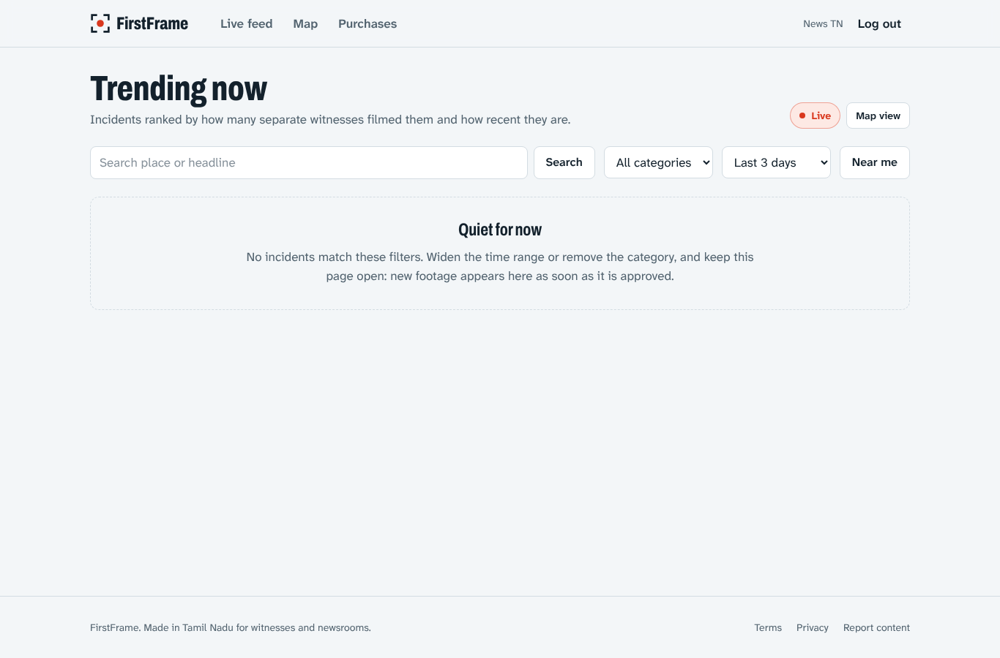
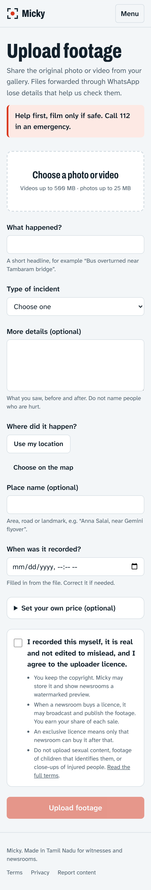

# Micky

**A marketplace where eyewitnesses sell incident footage to news channels.**

When a fire, accident or flood happens, reporters usually arrive after it's over. The best footage is on bystanders' phones, and newsrooms have no easy way to reach it. Micky lets the public upload photos and videos of incidents. The platform checks them for AI generation and tampering, and approved news channels preview them under a watermark and buy a licence. The uploader earns 70% of every sale.


<p>
  
  
</p>

## How it works

1. **A witness uploads** a video or photo from their phone, with location and capture time.
2. **A background worker processes it.** It checks file type and size, rejects exact and near duplicates, looks for the labels AI tools write into their own files (Midjourney, DALL·E, Stable Diffusion, Google, Adobe, the IPTC "AI-generated" tag), and asks the verification service for an AI-detector score and C2PA provenance. It cross-checks GPS and time metadata, then writes a risk level with the reasons.
3. **An admin reviews it** with those signals beside a watermarked preview, then approves or rejects it.
4. **Approved newsrooms browse incidents** on a live feed and map. Uploads near each other in place and time are grouped into one incident and ranked by a trending score. Each newsroom gets its own preview with its name burned into the picture, so a leaked copy is traceable.
5. **A newsroom buys a licence**, non-exclusive or exclusive, through Razorpay. It downloads a copy with the uploader's identifying metadata removed, through a single-use link bound to the buyer.
6. **The uploader's earnings** become available after a hold period that protects against chargebacks, then are paid out by UPI.

## Highlights

| Area | What's interesting |
|---|---|
| Payments | Integer paise everywhere. The ledger is append-only with database CHECK and unique constraints. Payments are verified as captured before a licence is granted. Webhooks are idempotent. Automatic refunds handle a lost exclusive race or an expired checkout. Credits are held, then reversed on chargeback. |
| Content protection | Watermarked HLS previews capped at 40% of the clip, rendered per newsroom with the viewer's name burned in. Preview tokens are short-lived and bound to the viewer. Previews stop for other newsrooms after an exclusive sale. Purchased files are delivered metadata-stripped. |
| Verification | A separate Python service runs AI-image detection, C2PA checks and perceptual hashing. The worker combines that with ffprobe/EXIF metadata into explainable risk signals. |
| Auth and security | JWT access tokens plus rotating refresh tokens, with reuse detection and an absolute session lifetime. Redis-backed rate limits and per-account login backoff. CSP, open-redirect protection, and an independent security review with every high finding fixed (see [`docs/REVIEW.md`](docs/REVIEW.md)). |
| Async processing | A BullMQ worker separate from the API, with retries, exponential backoff and idempotent steps. FFmpeg runs without a shell and with pixel and time limits. |
| Realtime | Socket.IO pushes newly approved footage and incident updates to newsrooms. |
| Ops | Docker images for amd64 and arm64. Production Compose with Caddy (automatic HTTPS), memory limits and private networks. Encrypted backups. CI with lint, typecheck, unit, API end-to-end and browser end-to-end tests. Deploys over SSH, behind a restricted gate. Designed to run for ₹0/month on Oracle Cloud's free tier. |

## Architecture

```
  Witness (PWA on phone)          Newsroom / Admin (web)
              \                        /
               Caddy  (HTTPS, reverse proxy, security headers)
              /                        \
     Next.js web app                NestJS API  ── Socket.IO (live alerts)
                                     │    │
                       PostgreSQL ───┘    └── Redis ── BullMQ worker
                       (Drizzle ORM)                   ├── FFmpeg: previews, delivery copies
                                                       └── Verifier (Python FastAPI):
                                                           AI score, C2PA, perceptual hash
                         Razorpay (payments, refunds)   Local disk or S3/R2 (media)
```

## Tech stack

| Layer | Technology |
|---|---|
| Web | Next.js (App Router), React, TypeScript, Tailwind CSS, hls.js, Leaflet + OpenStreetMap, installable PWA |
| API | Node.js 22, NestJS, TypeScript, Drizzle ORM, class-validator, Socket.IO |
| Database / queue | PostgreSQL 16, Redis 7, BullMQ |
| Media | FFmpeg / ffprobe (HLS previews, watermarks, metadata stripping) |
| Verification | Python 3, FastAPI, perceptual hashing, C2PA, optional PyTorch AI-image model |
| Payments | Razorpay (mock provider for local development) |
| Testing | Vitest, Supertest, Pytest, Playwright |
| Infrastructure | Docker, Docker Compose, Caddy, GitHub Actions, GHCR, Cloudflare, Oracle Cloud Always Free |

## Run it locally

You need Docker. Then:

```bash
git clone https://github.com/Sukumar-Manivel/Micky.git && cd Micky
make up      # builds and starts postgres, redis, verifier, api, worker and web
make seed    # creates the admin: admin@micky.local / change-this-admin-password
```

Open http://localhost:3000. The API health check is http://localhost:4000/api/v1/health. Payments use a mock checkout locally, so no Razorpay account is needed.

To develop without Docker, see [`apps/api/README.md`](apps/api/README.md) and [`services/verifier/README.md`](services/verifier/README.md). For the web app, copy `apps/web/.env.example` to `.env.local` and run `npm run dev`.

## Tests

| Suite | Command | Count |
|---|---|---|
| API unit | `cd apps/api && npm test` | 129 |
| API end-to-end (real Postgres + Redis) | `cd apps/api && npm run test:e2e` | 191 |
| Web unit | `cd apps/web && npx vitest run` | 57 |
| Verifier | `cd services/verifier && pytest` | 51 |
| Browser end-to-end (the full money path, from upload to payout) | `make e2e` | 15 |

See [`docs/TESTING.md`](docs/TESTING.md) for the strategy.

## Documentation

| Document | What's in it |
|---|---|
| [`docs/API.md`](docs/API.md) | REST and realtime API contract |
| [`docs/DEPLOYMENT.md`](docs/DEPLOYMENT.md) | Step-by-step free-tier deployment (Oracle Cloud + Cloudflare + R2) |
| [`docs/RESEARCH.md`](docs/RESEARCH.md) | Market, free-tier, payments, legal and verification research |
| [`docs/REVIEW.md`](docs/REVIEW.md) | Independent security review and fix status |
| [`docs/TESTING.md`](docs/TESTING.md) | Test pyramid and how to run every suite |
| [`docs/learning/`](docs/learning) | How each part works, with interview questions and answers |

## Project status

The core product is complete and tested:
- upload and processing;
- verification and admin review;
- the newsroom feed, map and live alerts;
- protected previews;
- licensing with refunds and chargebacks;
- earnings and payouts;
- deployment.

Before taking real money, the remaining steps are the business ones: Razorpay live KYC, a lawyer's review of the terms and privacy policy, and email notifications.

## Author

**Sukumar Manivel** · [GitHub](https://github.com/Sukumar-Manivel)
